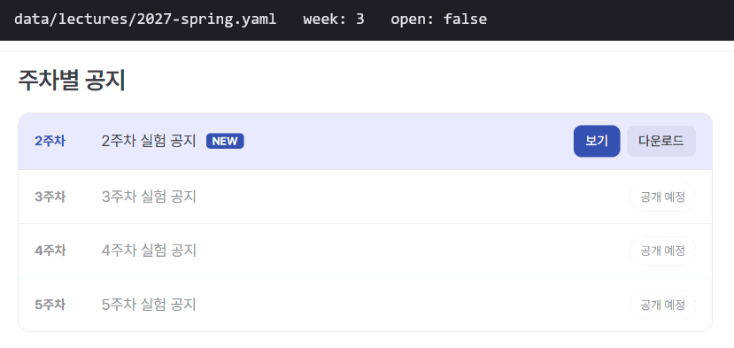
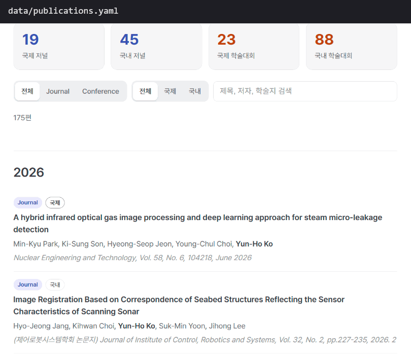

# ISL 홈페이지

충남대학교 영상 시스템 연구실(Image System Laboratory) 홈페이지 https://isl-homepage.github.io 의 소스입니다.
[VitePress](https://vitepress.dev)로 만들었습니다. 내용은 대부분 `data/` 폴더의 yaml 파일 한두 줄만 고치면 바뀝니다.

```bash
sh scripts/setup.sh   # 처음 한 번: Node.js 설치(없을 때만), 패키지 설치
npm run dev           # 내 컴퓨터에서 확인: http://localhost:5173
npm run deploy        # 사이트에 배포
```

## 처음 시작하기

### 1. 필요한 것

- **Git**: Windows는 [Git for Windows](https://git-scm.com/download/win)를 설치합니다. 아래 명령은 모두 **Git Bash**에서 실행합니다.
- **GitHub 계정과 저장소 쓰기 권한**: `ISL-Homepage/ISL-Homepage.github.io` 저장소에 push 할 수 있어야 배포할 수 있습니다.
  처음이면 [SSH 키를 등록](https://docs.github.com/ko/authentication/connecting-to-github-with-ssh/adding-a-new-ssh-key-to-your-github-account)합니다.
- 편집기는 [VS Code](https://code.visualstudio.com)를 권장합니다. yaml 들여쓰기 실수를 바로 보여 줍니다.
- Node.js는 따로 설치하지 않아도 됩니다. 아래 `setup.sh`가 없으면 설치합니다.

### 2. 받기와 준비

```bash
git clone -b source git@github.com:ISL-Homepage/ISL-Homepage.github.io.git isl-homepage
cd isl-homepage
sh scripts/setup.sh
```

`setup.sh`는 이미 된 것은 건너뛰고 다음을 합니다.

1. Node.js 20 이상이 없으면 설치 (Windows는 winget, macOS는 Homebrew)
2. 한글 파일 이름이 깨져 보이지 않게 git 설정
3. `npm ci`로 패키지 설치
4. `npm run data`로 데이터 검사와 세미나 썸네일 생성

Windows에서 Node.js를 새로 설치했다면 **Git Bash를 닫고 새로 연 뒤** 다음 단계로 갑니다.

### 3. 확인

```bash
npm run dev
```

브라우저에서 http://localhost:5173 을 엽니다. 파일을 저장하면 화면이 바로 바뀝니다. 끄려면 터미널에서 `Ctrl + C`.

## 평소 작업 흐름

```bash
git pull              # 1. 다른 사람이 바꾼 내용 받기
npm run dev           # 2. 켜 두고 파일 고치면서 화면 확인
npm run deploy        # 3. 배포 (검사 → 빌드 → 바뀐 파일 확인 → 커밋 → push)
```

`npm run deploy`는 아래 순서로 진행하고, 하나라도 실패하면 아무것도 올리지 않습니다.

1. 새로 넣은 세미나 PDF를 목록에 자동 추가
2. 데이터 검사. 문제가 있으면 **파일, 줄 번호, 고칠 내용**을 보여 줍니다
3. 사이트 빌드
4. 바뀐 파일 목록을 보여 주고 `y`를 누르면 커밋
5. 한 번 더 `y`를 누르면 push. 1~2분 뒤 사이트에 반영됩니다

커밋 메시지를 직접 적으려면 `npm run deploy -- "3주차 공지 열기"`.

### 공개 전에 미리 보여 주기 (`/temp`)

```bash
npm run deploy:preview
```

지금 사이트는 그대로 두고 https://isl-homepage.github.io/temp/ 에만 새 버전을 올립니다.
교수님이나 관리자에게 먼저 보여 줄 때 씁니다. 소스는 커밋하지 않습니다.

### 저장소 구조 (알아 두면 좋은 것)

| 브랜치 | 내용 |
|---|---|
| `source` | 이 소스 코드. 평소 작업하는 곳 |
| `master` | 빌드된 결과물. GitHub Pages가 이 브랜치를 그대로 보여 줌. **직접 고치지 않습니다** |

`npm run deploy`가 `source`를 빌드해 `master`에 올립니다. GitHub 웹에서 `source`의 파일을 고쳐도 사이트는 바뀌지 않습니다.
웹에서 고쳤다면 누군가 `git pull` 후 `npm run deploy`를 해야 반영됩니다.

## 자주 하는 일

| 하고 싶은 일 | 고칠 곳 |
|---|---|
| 이번 주 실험 공지 열기 | `data/lectures/<연도>-<학기>.yaml`에서 그 주차 `open: false`를 `true`로 ([설명](#강의-전자회로실험-등)) |
| 새 학기 강의 준비 | 작년 학기 yaml을 복사해 새 파일 만들기 ([설명](#새-학기-만들기)) |
| 세미나 자료 올리기 | PDF를 `public/attachments/seminar/<연도>/`에 `YYYYMMDD_발표자_제목.pdf` 이름으로 넣기 ([설명](#세미나-자료)) |
| 논문 추가 | `data/publications.yaml`에 항목 하나 추가 ([설명](#논문)) |
| 연구 과제, 저서 추가 | `data/projects.yaml`에 항목 하나 추가 ([설명](#연구-과제와-저서)) |
| 사람 추가, 졸업 처리, 랩장 교체 | `data/people.yaml` ([설명](#사람)) |
| 연구 장비 추가 | `data/equipment.yaml` (사진은 `public/images/equipment/`) |
| 홈 화면 문구, 이미지, 카드 | `index.md` 맨 위 ([설명](#홈-화면)) |
| 상단 메뉴 | `.vitepress/config.mts`의 `nav` |

공통 규칙:

- yaml 들여쓰기는 **스페이스 두 칸**입니다. 탭을 쓰면 안 됩니다.
- 파일 이름에 공백과 한글은 써도 되지만 `#`은 안 됩니다.
- "최종 수정" 날짜는 커밋 시각으로 자동 표시됩니다.
- 무엇이든 틀리면 `npm run dev`나 `npm run deploy`가 줄 번호와 함께 알려 줍니다.

## 강의 (전자회로실험 등)

학기마다 yaml 파일 하나로 관리합니다.

```
data/lectures/2026-spring.yaml   2026년 1학기 (전자회로실험)
data/lectures/2026-fall.yaml     2026년 2학기 (프로그래밍응용)
```

화면에는 **가장 최근 연도**의 1학기, 2학기만 나옵니다. 지난 학기 파일은 지우지 않고 두면 됩니다(기록용).

### 매주 공지 열기

학기 초에 그 학기 공지를 모두 `open: false`로 적어 두고, 매주 해당 주차만 `true`로 바꾼 뒤 `npm run deploy`.

```yaml
    notices:
      - week: 2
        file: lecture/2027-spring/2주차 실험 공지.pdf
        open: true          # 공개
      - week: 3
        file: lecture/2027-spring/3주차 실험 공지.pdf
        open: false         # "공개 예정"으로 흐리게 보임
```



- `file`은 `public/attachments/` 기준 경로입니다.
- 마지막으로 연 공지에 `NEW` 표시가 붙습니다.
- `title`을 안 적으면 "N주차 실험 공지"로 나옵니다. 중간고사처럼 파일 없는 주차는 `title`만 적습니다.
- `week` 없이 `title`만 적은 공지(예: 프로젝트 설계 공지)는 목록 맨 아래에 나옵니다.
- 강의 계획서, 보고서 양식처럼 학기 내내 쓰는 자료는 `materials`에 적습니다.

### 새 학기 만들기

예: 2027년 1학기 전자회로실험

1. PDF를 `public/attachments/lecture/2027-spring/`에 넣습니다. (2주차부터 마지막 주차까지 미리 넣어 둬도 됩니다)
2. `data/lectures/2026-spring.yaml`을 복사해 `data/lectures/2027-spring.yaml`로 저장합니다.
3. 새 파일에서
   - `year: 2027`로 고치고, `ended: true` 줄이 있으면 지웁니다.
   - `materials`의 강의 계획서 파일을 새 파일로 바꿉니다.
   - `notices`의 `file`을 새 경로로 바꾸고, `open`을 모두 `false`로 바꿉니다.
4. `npm run dev`로 확인하고 `npm run deploy`.

2027 파일이 생기는 순간 화면은 2027년만 보여 줍니다. 2학기 파일이 아직 없으면 2학기 칸은 "개설된 강의가 없습니다"로 나옵니다.

### 종강

따로 할 일은 없습니다. **1학기는 7월 1일, 2학기는 다음 해 1월 1일**부터 과목 페이지에 공지 대신
"강의가 끝났습니다, 다음 학기 준비 중" 안내가 자동으로 나옵니다. 그보다 일찍 닫으려면 그 학기 yaml 맨 위에 `ended: true`를 적습니다.

자료와 공지가 하나도 없는 과목(예: 개강 전)은 "강의를 준비하고 있습니다" 안내가 나옵니다.

### 새 과목 추가

yaml의 `courses`에 항목을 추가하고, `lecture/experiments.md`를 복사해 `lecture/<id>.md`로 만든 뒤 제목과 `id`만 바꿉니다.
상단 메뉴는 `.vitepress/config.mts`의 `nav`에 추가합니다.

## 세미나 자료

PDF를 `public/attachments/seminar/<연도>/`에 **`YYYYMMDD_발표자_제목.pdf`** 이름으로 넣으면 끝입니다.
예: `public/attachments/seminar/2026/20260301_홍길동_Visual SLAM 소개.pdf`

`npm run dev`나 `npm run deploy`를 실행하면 파일 이름에서 날짜, 발표자, 제목을 읽어 `data/seminars.yaml`에 자동으로 추가하고,
PDF 첫 페이지로 카드 썸네일도 만듭니다.

- 설명(`desc`)을 붙이거나 제목을 다듬고 싶으면 추가된 항목을 고칩니다. 한번 들어간 PDF는 다시 건드리지 않습니다.
- 파일 이름 형식이 다르면 오류로 알려 줍니다. 이름을 바꾸거나 yaml에 직접 적습니다.
   ```yaml
   - date: 2026-03-01
     title: "발표 제목"
     speaker: "홍길동"
     desc: "한 줄 설명 (선택)"
     file: "2026/20260301_홍길동_발표제목.pdf"
   ```

## 논문

`data/publications.yaml`에 항목을 추가합니다. 위치는 상관없습니다. 저널/학회, 국제/국내 구분과 연도별 정렬은 자동입니다.

```yaml
- type: journal              # journal 또는 conference
  scope: international       # international 또는 domestic
  year: 2026
  authors: "Gil-Dong Hong, Yun-Ho Ko"
  title: "논문 제목"
  venue: "학술지 또는 학회 이름, Vol., pp., 날짜"
  url: "https://doi.org/10.xxxx/xxxx"   # 선택. 있으면 제목이 링크가 됩니다
```



저자 중 교수님 이름(고윤호, Yun-Ho Ko)은 자동으로 굵게 표시됩니다.

## 연구 과제와 저서

Research > Project 페이지는 `data/projects.yaml`로 그립니다. 시작일 기준 최신순, 연도별 타임라인은 자동입니다.

```yaml
projects:
  - title: "과제 이름"
    org: "발주 기관"
    program: "사업 이름"         # 선택
    start: 2026-03-01
    end: 2027-02-28             # 생략하면 맨 위 "진행 중인 과제"에 표시
books:
  - title: "책 제목"
    authors: "저자1, 저자2"
    publisher: "출판사"
    date: 2009-02-20
    isbn: "978-89-7393-538-3"   # 선택
    cover: "9788973935383.jpg"  # 선택. public/images/books/ 안의 표지
    url: "https://..."          # 선택. 누르면 열릴 서점 페이지
```

- 진행 중인 과제가 하나도 없으면 "진행 중인 과제" 칸은 화면에 나오지 않습니다.
- 과제가 끝나면 `end`를 적습니다. "수행한 과제" 타임라인으로 옮겨집니다.
- 과제 기간과 기관은 [NTIS](https://www.ntis.go.kr) 과제 검색에서 확인할 수 있습니다.

## 사람

`data/people.yaml`에서 고칩니다. 교수님 정보는 `people/index.md` 본문에 있습니다.

```yaml
- group: M.S Candidates            # 구분 (Ph.D Candidates, M.S Candidates, Undergraduates, Alumni)
  members:
    - { name: 홍길동, photo: 홍길동.jpg }                 # 사진은 public/images/people/
    - { name: 김철수, affiliation: 한국전자통신연구원 }     # 소속 (졸업생 등)
    - { name: 이영희, leader: true }                    # 랩장 (한 명만)
```

- **새 사람**: 해당 `group`의 `members`에 한 줄 추가. 사진은 얼굴이 가운데 오는 정사각형(400×400 정도)으로 `public/images/people/`에 넣습니다. 사진이 없으면 기본 아바타가 나옵니다.
- **졸업**: 그 줄을 잘라서 `Alumni`로 옮기고 `affiliation`에 새 소속을 적습니다.
- **랩장 교체**: 이전 랩장의 `leader: true`를 지우고 새 사람에게 붙입니다. 두 명이면 오류로 알려 줍니다.

## 홈 화면

`index.md` 맨 위 `---` 사이만 고칩니다.

| 항목 | 내용 |
|---|---|
| `hero` | 큰 제목, 소개 문구, 버튼 |
| `showcase` | 오른쪽에서 차례로 바뀌는 연구 이미지(GIF 가능). `duration`으로 한 장 머무는 시간(초) |
| `features` | 아래 카드 |

```yaml
showcase:
  - src: /images/showcase_slam.gif       # public/images/ 안의 파일
    caption: Visual SLAM (RAF Set SLAM)  # 카드 아래 이름
    link: /research/interests            # 누르면 이동할 곳 (선택)
    duration: 8                          # 이 장만 머무는 시간(초, 선택). GIF는 한 바퀴 길이에 맞춤
features:
  - icon:
      src: /images/home/seminar.jpg      # 카드 위 사진
    title: Seminar
    details: 2014년부터 이어진 연구실 세미나 발표 자료
    link: /seminar/
```

- 이미지는 가로가 세로의 약 2.3배일 때 꽉 찹니다.
- 홈 카드 사진은 `node tools/make-home-cards.mjs`, favicon은 `node tools/make-favicon.mjs`로 만듭니다. 쓰는 이미지는 각 파일 안에서 고칩니다.

## 문제 해결

| 증상 | 해결 |
|---|---|
| `✖ 데이터 검사: 고쳐야 할 곳 N개` | 메시지의 파일과 줄 번호를 고칩니다. 대부분 들여쓰기, 따옴표, 콜론 뒤 공백 문제입니다 |
| `원격에 새 커밋이 N개 있습니다` | `git pull --rebase` 후 다시 `npm run deploy` |
| `npm run dev`가 `EBUSY` 오류로 꺼짐 | 개발 서버를 켠 채로 빌드나 배포를 하면 생깁니다. 서버를 끄고 다시 `npm run dev` |
| `node: command not found` | Node.js 설치 직후라면 Git Bash를 새로 엽니다. 그래도 안 되면 `sh scripts/setup.sh` |
| 한글 파일 이름이 `\354\240...`로 보임 | `git config core.quotepath false` (setup.sh가 해 줌) |
| 바꿨는데 사이트가 그대로 | 1~2분 기다린 뒤 강력 새로고침(Ctrl+Shift+R). 저장소 Actions 탭의 pages build 상태 확인 |

## 폴더 구조

```
index.md                 홈 (hero, 연구 이미지 슬라이드, 카드)
about/ people/ publication/ research/ lecture/ seminar/   각 메뉴 페이지
data/                    세미나, 논문, 사람, 장비, 과제 데이터(yaml)와 로더
data/lectures/           강의 학기별 데이터(yaml)
public/images/           이미지 (people/, equipment/, books/, home/)
public/attachments/      강의 첨부, 세미나 PDF
scripts/                 준비(setup.sh), 세미나 PDF 반영, 데이터 검사, 썸네일, 배포
tools/                   favicon, 홈 카드 이미지 생성
.vitepress/config.mts    사이트 설정, 메뉴
.vitepress/theme/        테마 확장, 컴포넌트, 색상
docs/                    README 이미지, 이전 기록
```

세미나 PDF 중 2014~2019년 자료는 옛 저장소에서 2020년 5월에 사라졌던 것을 git 기록(`00516ee`)에서 복구한 것입니다.
